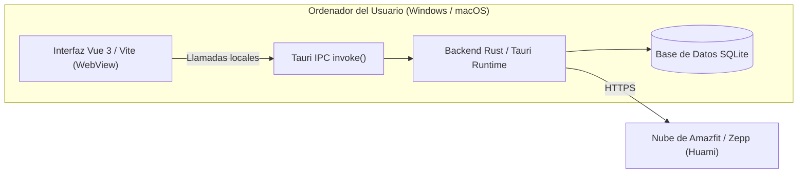
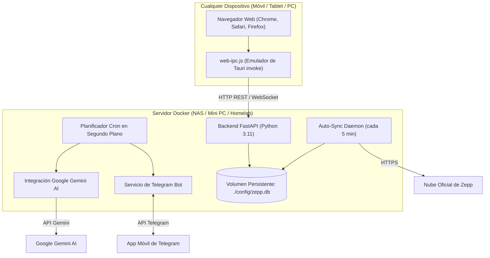

# Comparativa y Diferencias: ZeppBridge Web vs ZeppBridge Original ⌚🔄

Este documento describe detalladamente las diferencias arquitectónicas, de infraestructura, funcionales y de experiencia de usuario entre el proyecto original **[ZeppBridge](https://github.com/lingcang728/ZeppBridge)** (creado por `lingcang728`) y este fork **[ZeppBridge Web (Docker)](https://github.com/milfer322/ZeppBridge)**.

---

## 📊 Tabla Comparativa Resumida

| Característica / Módulo | ZeppBridge Original (Tauri Desktop) | ZeppBridge Web (Este Fork Docker) |
| :--- | :--- | :--- |
| **Plataforma de Ejecución** | Aplicación nativa de escritorio (Rust + Tauri v2) para Windows y macOS. | Contenedor Docker autónomo (FastAPI + Vue 3 / Vite) para servidores, NAS o mini PCs. |
| **Acceso del Usuario** | Requiere instalar y ejecutar el ejecutable `.exe` / `.dmg` en cada equipo cliente. | **100% en el Navegador Web (Web SPA)** desde cualquier PC, teléfono móvil o tablet. |
| **Consumo de Recursos** | Requiere entorno gráfico de escritorio y memoria del cliente. | Servidor headless ultraligero (< 60 MB RAM en reposo) sin escritorio virtual (sin VNC ni Selkies). |
| **Capa de Comunicación IPC** | Invocación nativa Tauri `@tauri-apps/api/core` (`invoke()`). | Interceptada de forma transparente por `web-ipc.js` y traducida a endpoints REST de FastAPI. |
| **Sincronización en 2º Plano** | Solo sincroniza mientras la app de escritorio permanezca abierta en el PC. | **Servicio 24/7 desatendido:** Sincronizador automático en segundo plano en el servidor (por defecto cada 5 min). |
| **Bot de Telegram** | No disponible. | **Bot interactivo bidireccional:** Comandos `/hoy`, `/buenosdias`, `/sync`, `/pulso`, `/informe`, `/entrenamientos`. |
| **Informes de IA Programados** | Consultas manuales puntuales dentro de la app con proveedores locales o chinos. | **Motor Cron + Google Gemini:** Informes periódicos automáticos y **reporte matutino "Buenos días"** al despertar. |
| **Formato de Horario** | Horario de 12 horas con AM / PM por defecto. | **Horario de 24 horas (00:00 - 23:59)** fijado por defecto en todo el sistema. |
| **Formato de Fechas** | Formato americano Mes/Día (MM/DD) en varias vistas y gráficas. | **Formato europeo/español Día/Mes (DD/MM)** aplicado en todas las gráficas, tablas y tooltips. |
| **Análisis Cardíaco Especializado** | Solo plantillas genéricas de sueño y workout. | **Nuevos intents de IA:** Módulos dedicados para 💓 Pulsaciones (7 días) y 📈 Cardio (30 días) evaluando HRV y RHR. |
| **Gestión de Respaldos (Backups)** | Base de datos SQLite guardada en carpetas del sistema operativo del usuario. | **Descarga de backup `.db` en 1 clic**, restauración directa desde la interfaz y exportador CSV para Excel. |
| **Planificador de Entrenamientos y Novedades Upstream** | Añadido en v3.0.3 - v3.0.6 en rama principal upstream. | **Totalmente preservado y sincronizado:** Soporta el diseñador de intervalos, retrospectiva de anillos, diario deportivo, deportes ampliados (#143) y carga TLB. |

---

## 🏗️ Diferencias de Arquitectura

### 1. ZeppBridge Original (Escritorio Tauri)

El proyecto oficial está diseñado como un cliente local monolítico de escritorio:

* **Inconveniente:** Para mantener tus datos sincronizados, debes tener tu ordenador personal encendido con la aplicación abierta. No es accesible desde el móvil fuera de casa ni desde otros dispositivos de la red.

---

### 2. ZeppBridge Web (Arquitectura Headless Web + Docker)

Este fork desacopla la interfaz de usuario de las dependencias nativas del sistema operativo mediante una capa de emulación IPC transparente y un servidor backend ligero en Python:

---

## 🔍 Detalle de Mejoras y Novedades Exclusivas

### 1. Emulador de IPC Web (`web-ipc.js`)
* En lugar de reescribir todo el código fuente del frontend oficial de ZeppBridge (lo que provocaría conflictos constantes al actualizar con el creador), se desarrolló un puente JavaScript `web-ipc.js`.
* Este archivo se inyecta en el frontend oficial e intercepta las llamadas `window.__TAURI__.core.invoke(command, payload)`.
* Las llamadas se traducen de forma instantánea a llamadas `fetch('/api/bridge/...')`, lo que permite que el frontend de ZeppBridge funcione en cualquier navegador web sin notar que ya no está dentro de Tauri.

### 2. Bot de Telegram Interactivo
* Puedes vincular un bot de Telegram con tu propio `token` y `chat_id`.
* El bot escucha mensajes de chat y permite:
  * `/hoy`: Resumen instantáneo de pasos, calorías, sueño y FC del día.
  * `/buenosdias`: Análisis matutino del último descanso nocturno.
  * `/sync`: Forzar una sincronización inmediata con los servidores de Zepp.
  * `/pulso`: Métricas de frecuencia cardíaca máxima, mínima y en reposo.
  * `/informe`: Solicitar un análisis clínico a Google Gemini en ese momento.

### 3. Informes Automáticos Programables (Cron + Gemini + Telegram)
* El usuario puede configurar tareas programadas con periodicidad diaria, semanal o mensual a horas específicas.
* A la hora configurada, el servidor recopila los datos biomédicos de la base de datos local SQLite, envía un prompt médico estructurado a **Google Gemini**, y envía el informe formateado directamente a tu canal de Telegram.
* **Informe Matutino "Buenos Días":** Un reporte automático diario (por defecto a las 08:30) que te despierta con una evaluación de la calidad de tu sueño, fases REM/profundo, pulso basal y un consejo motivacional para tu jornada deportiva.

### 4. Adaptación Horaria y Regional (24h y DD/MM)
* En la versión original de escritorio, las horas se muestran frecuentemente en formato americano de 12 horas con AM/PM y las fechas en formato Mes/Día (MM/DD).
* Este fork preconfigura y fija por defecto:
  * **Horario de 24 horas (00:00 a 23:59)** en toda la interfaz.
  * **Formato Día/Mes (DD/MM)** en todas las gráficas de Recharts (frecuencia cardíaca, pasos, sueño), tablas de actividades y modales de entrenamiento.

### 5. Copias de Seguridad y Portabilidad
* Menú de copia de seguridad con descarga directa de la base de datos SQLite `zepp.db`.
* Función para restaurar una base de datos directamente desde el navegador web.
* Exportación de entrenamientos y métricas diarias a formato `.csv` compatible con Excel y Google Sheets.

### 6. Métricas Reales en Estado de Entrenamiento (Training Load, Balance TLB y Zonas de FC)
* **Carga de Entrenamiento y Ratio Agudo:Crónico (TLB):** Zepp no registra la carga de entrenamiento en `daily_metrics`, sino por sesión en `workouts`. El fork calcula automáticamente el histórico móvil de fatiga (7 días), fitness (28 días) y ratio de carga para mostrar el estado de equilibrio de entrenamiento real.
* **Zonas de Frecuencia Cardíaca Dinámicas:** En la versión base las zonas de FC (`/training`) estaban fijadas con 0 segundos y límites estáticos. Este fork calcula los umbrales personalizados según tu frecuencia máxima real (Zonas 1 a 5) y computa el tiempo real invertido en cada zona a partir de las muestras de entrenamiento (`workout_samples`) y registros de pulso.
* **Compatibilidad Universal con Portapapeles:** Polyfill para copia segura en entornos web HTTP / no-HTTPS, evitando errores de `writeText`.

---

## 🔄 Compatibilidad con el Proyecto Upstream

Este fork mantiene una sincronización estricta con las versiones oficiales de `lingcang728/ZeppBridge`:
* **Versión Base Sincronizada:** **v3.0.6** (release oficial **v3.0.5** y rama `main` upstream, incorporando deportes adicionales #143, canal avanzado de distancias, retrospectiva anual de anillos y diario de actividad).
* Los parches se aplican de forma no destructiva mediante `patch-frontend.cjs` durante el proceso de construcción de la imagen de Docker, lo que garantiza que cualquier corrección o nueva función añadida por el autor original pueda incorporarse sin romper la funcionalidad web.
